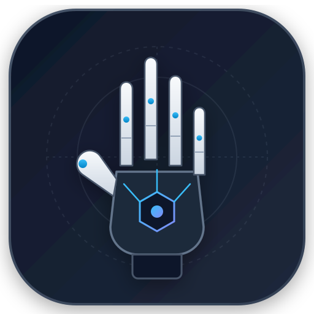

<p align="center">
  
</p>

<h1 align="center">AgentHands</h1>

<p align="center">
  <strong>Personal Account Action Framework for AI Agents without Developer APIs</strong><br>
  Known colloquially as "Agent 大手子" (Master Hands).<br>
  Empowering AI Agents with authentic, controllable hands and feet across mainstream platforms without enterprise developer restrictions.
</p>

<p align="center">
  <a href="LICENSE"></a>
  <a href="https://www.python.org/"></a>
  <a href="https://github.com/Tiggy-Chan/AgentHands/stargazers"></a>
</p>

<p align="center">
  <a href="README.md">简体中文</a> · <strong>English</strong>
</p>

---

## Why AgentHands?

Modern Large Language Models (LLMs) and autonomous coding agents (Claude Code, OpenAI Codex, Hermes Agent) possess powerful analytical and decision-making brains. However, when interfacing with real-world web platforms, developers frequently hit insurmountable engineering barriers:

1. **Enterprise Privilege Walls**: Official developer APIs are predominantly restricted to certified enterprise entities, demanding business licenses, complex App ID/Secret applications, and multi-tier tenant administrative reviews that individual developers cannot fulfill;
2. **Deficient Capabilities**: Official bot APIs generally prevent acting as the authentic human user (e.g., reading/writing direct messages, in-place cloud document surgery, managing seller inventory and order fulfillment, or administering private communities);
3. **The Read vs. Action Gap**: Read-only tools (such as Agent-Reach) provide the "eyes and ears" for web perception, but fail to empower agents to conduct state mutations or business fulfillment;
4. **Hallucination and Runway Risk**: Granting unrestricted write capabilities directly to agents risks catastrophic accidental deletes, spamming, or token exposure.

**AgentHands is built to dismantle these barriers**:
- **Zero Official API Gatekeeping**: Operates directly via personal web session cookies, internal REST/GraphQL gateways, or controlled headless browsers, granting capabilities equivalent to human browser operations;
- **Industrial-Grade Protocol Implementations**: Native Protobuf gateways, persistent WebSockets, mobile sign calculation, virtualized DOM tree traversal, and block AST editing;
- **Agent-First Dual-Gate Safety**: Hardware/environment-level write locks + SHA-256 draft fingerprint verification + memory-level dynamic credential scrubbing to ensure every write action remains strictly bounded and authorized.

---

## Platform Support Matrix

AgentHands covers communications, social content, e-commerce, and multimedia streaming:

| Platform | Underlying Protocol | Core Action Surface | Write Gate Identifier |
|---|---|---|---|
| **Feishu (Lark)** | Internal Protobuf + WebSocket + Virtual DOM | Message sending/receiving, native file delivery (Type 3/13), in-place document replacement, block AST surgical editing, calendar management, local AES-256-GCM event store | `FEISHU_ALLOW_SEND`<br>`FEISHU_ALLOW_WRITE` |
| **Bilibili** | Web Cookie + Dynamic Wbi Signatures | Video metrics lookup, likes/coins/favorites/triple combo, hierarchical comment replies, text/image dynamic feeds, direct messaging, video chunked submission | `BILIBILI_WRITE_ALLOWED` |
| **Xianyu (Goofish)** | Alibaba MTOP Gateway + Pure Python MD5 | Commodity publishing, price updates, detail editing, shelf toggles, seller order inspection, waybill shipment fulfillment, cancellation, marketplace search | `XIANYU_WRITE_ALLOWED` |
| **Xiaohongshu (RedNote)** | Creator Center Controlled Browser + Shadow DOM | Image-text note publishing (1-9 images/card styles/hashtags), video note publishing with Shadow DOM submission, note metrics extraction, comment threads, creator analytics | `XIAOHONGSHU_WRITE_ALLOWED` |
| **QQ (OneBot 11)** | Standard OneBot 11 HTTP Specification | Direct messaging, group message dispatch, message recall, chat history retrieval, group member mute/kick governance | `QQ_WRITE_ALLOWED` |
| **X (Twitter)** | Internal Web GraphQL Gateway | Tweet publishing, tweet replies, tweet deletion, like/retweet interactions, personal bookmark export, public user profile queries | `X_WRITE_ALLOWED` |
| **Reddit** | Internal Web REST Endpoints | Subreddit feed browsing (hot/new/top), discussion tree retrieval, text/link submissions, comment posting/replies, upvoting/downvoting | `REDDIT_WRITE_ALLOWED` |
| **Telegram** | Local Gateway / MTProto / Bot API | Direct messages and channel broadcasts, message recall, chat history retrieval, community metadata queries | `TELEGRAM_WRITE_ALLOWED` |
| **YouTube** | InnerTube Internal Gateway + Studio API | Video detail retrieval, video metadata batch updating (title/description/privacy), likes/dislikes, comment replies, Community tab updates | `YOUTUBE_WRITE_ALLOWED` |

---

## Controlled Write Safety: Dual-Gate Architecture

AgentHands enforces defensive safety mechanisms directly at the communication layer:

1. **Physical Environment Gate**: Mutating actions are severed by default. Without an explicitly defined environment flag (such as `XIANYU_WRITE_ALLOWED=1`), the CLI refuses to dispatch mutating requests to the network;
2. **SHA-256 Intent Fingerprinting**: Every mutating command prints a structured intent draft with a SHA-256 digest and immediately exits without side effects. Only passing `--execute --fingerprint <FP>` matching the exact content will unlock execution. Any minor modification to text or parameters invalidates the fingerprint;
3. **Global In-Memory Credential Redaction (`register_secret`)**: Extracted cookies, tokens, and keys are registered in the global secret register upon entering memory. Terminal outputs, stack traces, and agent reflection logs are dynamically sanitized;
4. **Explicit Untrusted Content Boundaries (`untrusted`)**: Ingested content from external feeds is enclosed in adaptive multi-bracket fences, ensuring the model treats external text strictly as data, preventing prompt injection.

---

## AgentHands Console (Management WebUI)

AgentHands bundles a lightweight management console built on FastAPI and a clean, dependency-free frontend:

- **Unified Session Dashboard**: Aggregate real-time session health, accounts, UIDs, and token expiration across all platforms;
- **QR Code Authentication Center**: Visual QR code generation with automated polling and credential persistence with `0600` permissions;
- **Human Governance Center**: Real-time visual toggles for each platform's write gate authorization;
- **Emergency Freeze**: A single button to immediately revoke all write privileges across all connected platforms during unexpected behavior or model drift.

```bash
# Launch the management console (default port 8990)
python3 -m webui --host 0.0.0.0 --port 8990
```

---

## Quick Start & CLI Specification

Every platform is packaged as a self-contained CLI utility where arguments follow standard `argparse`, structured output goes to `stdout`, and progress or diagnostics stream to `stderr`:

```bash
# 1. Account probe & authentication check
skills/bilibili/scripts/bilibili.py whoami --json
skills/xianyu/scripts/xianyu.py whoami --json

# 2. Safe write: Generate draft fingerprint (blocked by default)
skills/bilibili/scripts/bilibili.py interact BV1xx411c7mD --triple

# 3. Execute write operation after human confirmation
skills/bilibili/scripts/bilibili.py interact BV1xx411c7mD --triple --execute --fingerprint <FINGERPRINT>

# 4. Direct execution in authorized automation workflows
skills/bilibili/scripts/bilibili.py comment BV1xx411c7mD "Great analysis!" --direct
```

---

## Automated Test Verification

This repository contains a comprehensive suite of offline unit tests operating in a fully sandboxed environment with zero network, zero real cookies, and zero external services:

```bash
# Run the offline test suite
./test.sh
```

---

## Repository Structure

```text
AgentHands/
├── assets/                  # Official vector assets and logo
├── skills/                  # Platform action implementations
│   ├── feishu/              # Feishu / Lark (Docs/Messages/Calendar/Store)
│   ├── bilibili/            # Bilibili (Dynamics/Uploads/Comments/Triples)
│   ├── xianyu/              # Xianyu (Commodities/Orders/Search/Addresses)
│   ├── xiaohongshu/         # Xiaohongshu (Images/Videos/Creator Center)
│   ├── qq/                  # QQ (Private/Group/Governance/OneBot 11)
│   ├── x/                   # X (Tweets/Replies/Bookmarks/GraphQL)
│   ├── reddit/              # Reddit (Posts/Comments/Votes/Subreddits)
│   ├── telegram/            # Telegram (Messages/Channels/History)
│   └── youtube/             # YouTube (Metadata/Interactions/Community)
├── webui/                   # Unified Management Console & Safety Center
├── test.sh                  # Top-level offline verification script
├── README.md                # Simplified Chinese documentation
├── README_en.md             # English documentation
└── LICENSE                  # MIT License
```

---

## License

This project is licensed under the [MIT License](LICENSE).  
Copyright (c) 2026 Tiggy-Chan. All Rights Reserved.
